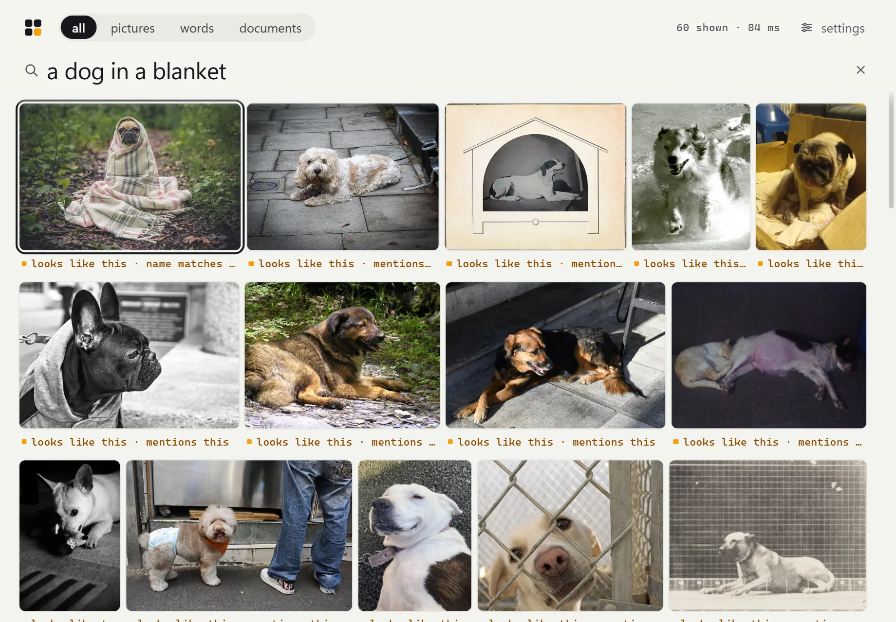
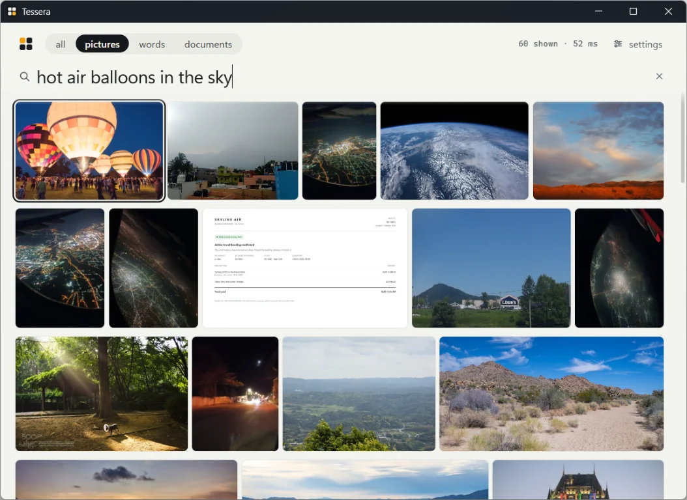
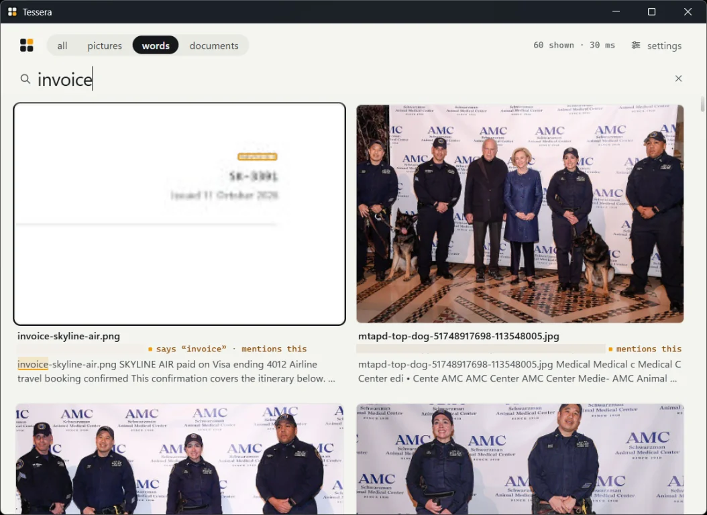
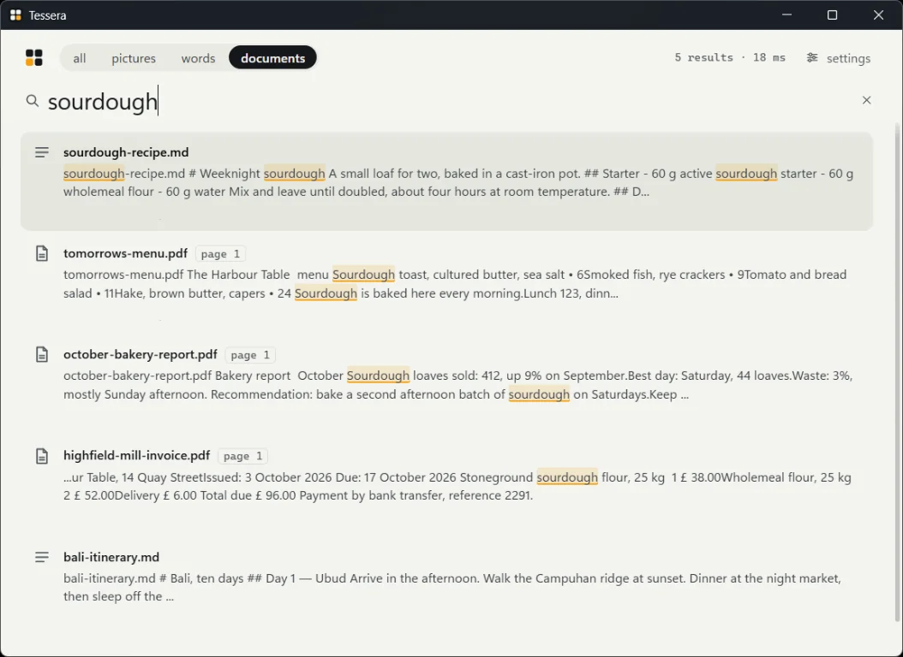

<div align="center">


# Tessera

**One search bar for everything your PC can't search.**<br>
Pictures, screenshots, PDFs and documents. Offline, free and open source.

[](#install)
[](https://github.com/rishabhx29/tessera/releases)
[](https://github.com/rishabhx29/tessera/actions/workflows/ci.yml)
[](LICENSE)
[](https://tesseraweb.vercel.app)

**[Download for Windows](https://github.com/rishabhx29/tessera/releases/latest/download/Tessera_x64-setup.exe)** · **[Website](https://tesseraweb.vercel.app)** · [All releases](https://github.com/rishabhx29/tessera/releases)

</div>

A *tessera* is one tile in a mosaic. Every screenshot, photo, page and document on your PC is a fragment. Tessera is the picture they add up to.

Type what you remember, not the filename. Tessera finds the screenshot by the words inside it, the photo by what it shows, and the document by what it says. It runs on your machine and never uploads a file.

## See it



Search *a dog in a blanket* and the photo comes back, with the reason it matched.

| Pictures | Words | Documents |
| :---: | :---: | :---: |
| <a href="website/public/media/lens-pictures.webp"></a> | <a href="website/public/media/lens-words.webp"></a> | <a href="website/public/media/lens-documents.webp"></a> |
| *hot air balloons in the sky*: photos by what they show | *invoice*: the text inside a screenshot | *sourdough*: files, with page and snippet |

## Install

**[Download Tessera for Windows (x64)](https://github.com/rishabhx29/tessera/releases/latest/download/Tessera_x64-setup.exe)** · [All releases](https://github.com/rishabhx29/tessera/releases)

1. Run `Tessera_x64-setup.exe`. It installs for the current user, so Windows does not ask for an administrator.
2. The installer is not code-signed yet. If SmartScreen asks, choose **More info**, then **Run anyway**.
3. On first launch Tessera downloads its on-device models once, about 1.6 GB, and checks each file against a SHA-256 pin compiled into the binary.
4. Add a folder. Tessera reads it in the background and indexes the newest files first.
5. Press **Ctrl+Alt+T** from anywhere to search.

Nothing else to install. There is no account, no key and no separate model package.

> [!NOTE]
> The first-run model download is the only time Tessera uses the network. Search never makes a network call.

**Requirements:** Windows 10 or 11 on x64. WebView2 ships with Windows 11 and current Windows 10; if it is missing, Tessera offers the Microsoft download. About 1.7 GB of disk for the models, plus about 14 MB of index per 1,000 files.

**Uninstall:** Settings > Apps > Installed apps > Tessera. Your models, index and settings live in `%LOCALAPPDATA%\TesseraData`; remove that folder to reclaim the space.

**Checksums:** each release carries `SHA256SUMS.txt` and `Tessera_x64-setup.exe.sha256`. Verify with `Get-FileHash Tessera_x64-setup.exe -Algorithm SHA256`.

## What it searches

| Kind | Formats | How it is read |
|---|---|---|
| Pictures | PNG, JPG, JPEG, WEBP, BMP, GIF, TIFF | OCR for the words, a local vision model for what the picture shows |
| Documents | PDF | The text layer, page by page. A PDF with no text layer is recorded as waiting for OCR, not dropped |
| Documents | DOCX | The document text |
| Text | TXT, MD, CSV, LOG | Chunked, with overlap, so a phrase across a boundary is still found |

Four lenses sit above the results. **All** mixes every format and says why each file matched. **Pictures** searches by what a picture looks like. **Words** searches the text inside pictures. **Documents** searches the text inside files.

Everything is one index in a single SQLite file. A moved file keeps its row, a changed file is read again, and a cloud-only file is skipped, never downloaded.

## How it works

```
Ctrl+Alt+T
    │
    ▼
Tauri 2 window  (vanilla ES modules, no bundler)
    │  search(query, lens, limit)
    ▼
tessera-core
    ├── lexical arm    FTS5 trigram + BM25
    ├── image arm      SigLIP
    └── meaning arm    MiniLM
             │  weighted RRF
             ▼
      one SQLite index
```

- **A pipeline per format.** Each format implements one `Pipeline` trait. Video in v0.2 becomes a new pipeline, and the store and search code do not change.
- **OCR behind a seam.** Windows OCR is the fast path. PP-OCRv6 on ONNX Runtime is the cross-platform fallback and reads more text.
- **Watch mode.** Newest files first, up to 4 workers, a pause on battery, and models loaded per drain instead of held at idle.
- **Moves, not duplicates.** Change detection uses mtime, size and SHA-1, so a renamed or moved file keeps its row.

## Measured, not promised

Every number below comes from [docs/performance.md](docs/performance.md), with its method and caveats. None are targets.

| What | p50 | p95 |
|---|---|---|
| Fused search, 5,000 files | **65 ms** | **80 ms** |
| Keyword arm | 17 ms | 58 ms |
| Picture arm | 36 ms | 46 ms |
| Meaning arm | 44 ms | 60 ms |
| Fused search, 50,000 files | 457 ms (target missed) | 523 ms |

At 50,000 files the 100 ms target is missed. The row stays in the table because a miss is a result. That drain ran at 10.8 files per second, and its index is 686 MB, about 13.7 MB per 1,000 files.

Caveats, all from the log: one machine, one run per configuration, a warm OS file cache, and a corpus that is about 31% real files. The p95 over 32 samples is close to the maximum, not a distribution estimate.

## Privacy

- No telemetry, no accounts, no ads, no paid tier.
- No network calls at query time. Search is local.
- The only network access is the first-run model download, checked against pins that are compiled into the binary.
- The index is one SQLite file in your data folder. Nothing leaves the machine.
- The source is MIT licensed. [SECURITY.md](SECURITY.md) records the full promise.

## Status and limits

Tessera is at **v0.1.0**, the first public release, and still early.

| Track | State |
|---|---|
| Windows x64 installer | ✅ Shipping |
| Engine on Linux and macOS | ✅ Compiles and tests in CI |
| Search at 50,000 files | ❌ 457 ms measured, target is 100 ms |
| Video | 🔜 v0.2 |
| Scanned PDFs with no text layer | 🔜 Recorded as waiting for OCR, not yet searchable |
| XLSX and PPTX | 🔜 Planned for v0.4 |

Files over 50 MB are skipped and counted, with the reason shown in diagnostics. OneDrive online-only placeholders are skipped, never downloaded. The roadmap and its kill criteria live in [ADR-0005](docs/adr/0005-phased-rollout-and-kill-criteria.md).

## Build from source

Prerequisites: Rust stable, Node.js 20 or newer, and the MSVC build tools on Windows. The build downloads a pinned ONNX Runtime.

```sh
git clone https://github.com/rishabhx29/tessera
cd tessera

# engine CLI
cargo run -p tessera-core

# desktop shell (installs the Tauri CLI on first use)
cd crates/app
npx @tauri-apps/cli dev
```

To build the installer:

```sh
cd crates/app
npx @tauri-apps/cli build
```

The installer lands in `target/release/bundle/nsis/`. On MSVC the build links ONNX Runtime statically, so the installer needs no extra dll. A GNU build that links the dll dynamically (`ORT_LIB_LOCATION`) must copy `onnxruntime.dll` beside `Tessera.exe` before bundling.

Gates that must pass before a change merges:

```sh
cargo fmt --all -- --check
cargo clippy --all-targets -- -D warnings
cargo test --all
```

## Documentation

- [Website](https://tesseraweb.vercel.app): download, FAQ and the privacy page
- [Product definition](docs/product-definition.md): the locked spec
- [Architecture](docs/architecture.md): crates, data model, per-format pipelines
- [Performance log](docs/performance.md): every measured number, with method
- [ADRs](docs/adr/): decisions that are expensive to reverse
- [Shared vocabulary](CONTEXT.md): the terms this project uses
- [Agent guide](agents.md): commands and phase rules for AI coding agents

Bug reports and testing plans are the most useful help right now. Read [CONTRIBUTING.md](CONTRIBUTING.md) before you open a PR.

---

[MIT](LICENSE) licensed. Built on open code and open models: ONNX Runtime, SigLIP, MiniLM, ViT-GPT2 and PP-OCRv6, with the Windows OCR API as the fast path. Every pin lives in [`crates/core/src/models/lock.json`](crates/core/src/models/lock.json).
